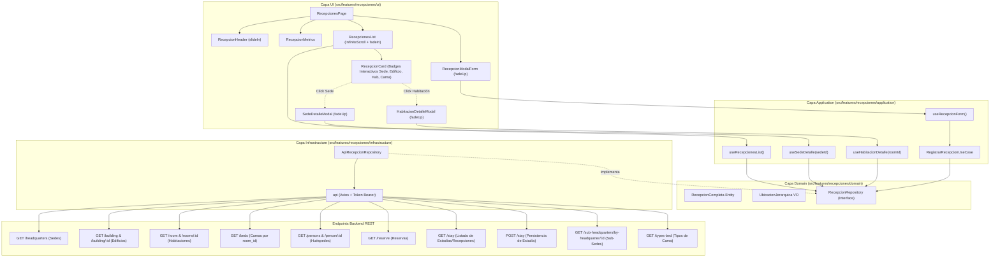

# Prompt: Creación de la Sección de Recepciones con Jerarquía Completa (Sede, Edificio, Habitación y Cama)

## Registro del Prompt Optimizado

```text
@[src/features/dashboard/dashboard-page.tsx]
@[src/features/recepciones/ui/recepciones-page.tsx]
@[src/features/recepciones/domain/recepcion.ts]
@[src/features/recepciones/infrastructure/api-recepcion-repository.ts]
@[src/features/recepciones/application/use-recepcion-form.ts]

Implementa la sección integral de recepciones y check-in de huéspedes en Nexora, garantizando la trazabilidad física y espacial completa (Sede ➔ Edificio ➔ Habitación ➔ Cama) tanto en el panel de visualización como en el flujo de registro.

### 1. Jerarquía Espacial y Modelo de Datos Enriquecido
Modifica el dominio (@[src/features/recepciones/domain/recepcion.ts]) para representar cada recepción con su contexto de ubicación completo:
- Sede: id, nombre, ciudad y dirección.
- Edificio: id, nombre y piso.
- Habitación: id, número/nombre, tipo y capacidad.
- Cama: id, etiqueta (ej. "Cama 01 - King Size"), tipo de cama y estado.
- Huésped (Persona): id, nombre completo, documento de identidad, teléfono y correo electrónico.
- Reserva previa (si existe): id, fecha check-in/out prevista y estado.
- Datos de estadía: fecha de check-in real, fecha estimada de check-out, método de pago, depósito de garantía, estado (en progreso, finalizada, cancelada) y observaciones.

### 2. Orquestación de Endpoints del Proyecto, Status Codes y Manejo de Excepciones (Infraestructura)
Extiende el repositorio (@[src/features/recepciones/infrastructure/api-recepcion-repository.ts]) consumiendo en paralelo y de forma resiliente los endpoints existentes en el backend. Cada llamada debe estar envuelta obligatoriamente en bloques `try / catch` con validación estricta de códigos HTTP y lanzamiento de excepciones tipadas del dominio (@[src/features/recepciones/domain/recepcion-error.ts]):

1. Sedes: GET /headquarters
   - Éxito: 200 OK ➔ Devuelve ApiSede[]
   - Errores: 401 Unauthorized, 500 Internal Server Error ➔ Lanza SedeApiError o fallback a caché
2. Edificios: GET /building y GET /building/{id}
   - Éxito: 200 OK ➔ Devuelve ApiBuilding[] o ApiBuilding
   - Errores: 400 Bad Request (id malformado), 404 Not Found, 500 ➔ Lanza EdificioApiError o fallback
3. Habitaciones: GET /room y GET /rooms/{id}
   - Éxito: 200 OK ➔ Devuelve ApiRoom[] o RoomApiResponse
   - Errores: 404 Not Found (habitación inexistente), 500 ➔ Lanza HabitacionApiError
4. Camas: GET /beds y POST /bed
   - Éxito GET: 200 OK ➔ Devuelve BedApiResponse[] (filtrables por room_id)
   - Éxito POST: 201 Created ➔ Cama registrada en habitación
   - Errores: 400 Bad Request, 404 Not Found (room_id inexistente), 409 Conflict (etiqueta duplicada), 500 ➔ Lanza CamaApiError
5. Huéspedes: GET /persons y GET /person/{id}
   - Éxito: 200 OK ➔ Devuelve PersonApiResponse[] o PersonApiResponse
   - Errores: 404 Not Found (persona no registrada), 500 ➔ Lanza PersonApiError o fallback a catálogo local
6. Reservas: GET /reserve
   - Éxito: 200 OK ➔ Devuelve RawReserva[]
   - Errores: 401 Unauthorized, 500 ➔ Lanza ReservaApiError
7. Consulta de Estadías / Recepciones: GET /stay
   - Éxito: 200 OK ➔ Devuelve StayApiResponse[] o { data: StayApiResponse[] }
   - Errores: 401 Unauthorized (token caducado), 404 Not Found, 500 ➔ Lanza RecepcionApiError o fallback a localStorage
8. Registro de Estadía / Recepción: POST /stay
   - Éxito: 201 Created ➔ Devuelve { id: string } con la estadía confirmada
   - Errores:
     * 400 Bad Request (campos obligatorios ausentes o formato de fecha inválido)
     * 401 Unauthorized (sin permisos de recepcionista)
     * 404 Not Found (room_id o person_id inexistente)
     * 409 Conflict (habitación o cama ya ocupada en las fechas seleccionadas)
     * 500 Internal Server Error (falla en base de datos)
     * Código 0 / Red (falla de conexión o timeout)
     ➔ Lanza RecepcionApiError(statusCode, serverMessage)
9. Sub-Sedes vinculadas: GET /sub-headquarters/by-headquarter/{headquarter_id}
   - Éxito: 200 OK ➔ Devuelve SubSede[]
   - Errores: 400 Bad Request, 404 Not Found (sede sin subsedes), 500 ➔ Retorna arreglo vacío sin romper la vista
10. Tipos de Cama: GET /types-bed
   - Éxito: 200 OK ➔ Devuelve TipoCama[] con capacidad y descripción
   - Errores: 500 ➔ Lanza TipoCamaApiError o utiliza diccionario por defecto

### Reglas Obligatorias de Try / Catch y Excepciones:
- Cada función del repositorio debe implementar la captura de errores mediante:
  ```typescript
  try {
    const response = await api.get('/endpoint', { validateStatus: (s) => s === 200 })
    return response.data
  } catch (error) {
    if (isAxiosError(error)) {
      const status = error.response?.status ?? 0
      const message = error.response?.data?.message || error.response?.data?.error || error.message
      throw new RecepcionApiError(status, message)
    }
    throw new RecepcionApiError(0, error instanceof Error ? error.message : 'Error inesperado')
  }
  ```
- En los Hooks de Aplicación (`useRecepcionForm`, `useRecepcionesList`, `useSedeDetalle`, `useHabitacionDetalle`), los bloques `try / catch` nunca deben dejar caer la aplicación; deben atrapar la excepción y transformar el `statusCode` en mensajes claros y tranquilizadores según el principio de la Heurística del Temor y Preservación de Datos.

### 3. Vistas y Componentes de la Sección (UI & UX)
Transforma @[src/features/recepciones/ui/recepciones-page.tsx] en un módulo completo y altamente interactivo:
1. Header de Sección:
   - Título psicológico cálido: "Recepción y bienvenida de huéspedes".
   - Subtítulo: "Supervisa las estadías activas en toda tu red y realiza nuevos check-ins con asignación precisa de sede, edificio, habitación y cama."
   - Animación de entrada: slideIn (motion/react).
   - Botón de acción destacada: "Nuevo check-in / Recepción" con variante primaria.
2. Barra de Métricas Rápidas:
   - Huéspedes hospedados hoy.
   - Habitaciones en uso vs. disponibles.
   - Camas ocupadas en la sede seleccionada.
   - Depósitos en custodia activos.
3. Listado de Recepciones Activas con Scroll Infinito:
   - Implementa filtrado rápido por Sede, Edificio, Estado y buscador de huésped.
   - Usa obligatoriamente el componente compartido InfiniteScroll.tsx.
   - Cada card de recepción entra con animación fadeIn y exhibe badges interactivos (clicables con hover sutil y cursor pointer):
     * Badge Sede (ej: "Sede Poblado") ➔ Clicable: abre el modal de inspección de la Sede, sus Sub-Sedes y Edificios.
     * Badge Edificio (ej: "Torre A · Piso 3")
     * Badge Habitación (ej: "Hab. 302 - Suite") ➔ Clicable: abre el modal de inspección de la Habitación, sus Camas y Tipos de Cama.
     * Badge Cama (ej: "Cama Principal King")
     * Datos del Huésped (Nombre, CC y Teléfono)
     * Fechas de ingreso y salida con contador de noches
     * Estado con chip de color ("Hospedado", "Finalizada")
4. Modal / Drawer de Check-in con Cascada Jerárquica:
   - Entrada con animación fadeUp.
   - Paso 1 (Opcional): Selector de Reserva previa. Si se selecciona, autocompleta huésped, sede, edificio, habitación y fechas.
   - Paso 2: Cascada de ubicación interactiva:
     * Selector de Sede (carga edificios de esa sede).
     * Selector de Edificio (carga habitaciones de ese edificio).
     * Selector de Habitación (carga camas configuradas en esa habitación).
     * Selector de Cama (muestra etiqueta y tipo de confort asignado).
   - Paso 3: Huésped principal, depósito de garantía, método de pago y notas.
   - Loader con overlay={true} y mensaje empático durante el POST /stay: "Registrando la recepción y asignando cama…".
   - Retroalimentación de éxito o error no alarmista que preserve los datos en caso de fallo.
5. Modales Interactivos de Inspección Rápida (Sede y Habitación):
   - Ambos con entrada suave mediante animación fadeUp y cierre con botón o tecla Escape:
   a) SedeDetalleModal:
      * Se activa al hacer clic en el nombre o badge de la Sede en cualquier card de recepción.
      * Muestra la ficha de la Sede: nombre, ciudad, dirección exacta, teléfono de contacto y estado.
      * Muestra las Sub-Sedes vinculadas consultando GET /sub-headquarters/by-headquarter/${sedeId}.
      * Muestra los Edificios pertenecientes a dicha sede (filtrados de GET /building por headquarters_id === sedeId), con cantidad de pisos y estado.
   b) HabitacionDetalleModal:
      * Se activa al hacer clic en el nombre o badge de la Habitación en cualquier card de recepción.
      * Muestra datos de la Habitación: número, piso, edificio asociado, tipo de habitación, precio y estado actual.
      * Muestra las Camas físicas instaladas en esa habitación (filtradas de GET /beds por room_id === habitacion.id), con su etiqueta y estado.
      * Muestra los Tipos de Cama asignados (consultando GET /types-bed), exhibiendo la capacidad en personas (capacity_people), descripción de confort y dimensiones.
```

---

## 🏛️ Arquitectura y Flujo de Datos (Vertical Slicing & Hexagonal)



---

## 🔌 Catálogo de Endpoints Consumidos y Relaciones

El sistema Nexora cuenta con endpoints distribuidos que representan las diferentes dimensiones del hotel. Para construir la sección de recepciones completa, el repositorio debe orquestar los siguientes servicios:

### 1. Sedes (Headquarters)
- **Endpoint:** `GET /headquarters`
- **Uso:** Obtener las sedes activas para el filtrado general y el primer nivel de la cascada de check-in.
- **Códigos HTTP:**
  * `200 OK`: Retorna `ApiSede[]` con las sedes disponibles.
  * `401 Unauthorized`: Token de sesión ausente o expirado.
  * `500 Internal Server Error`: Fallo interno del servidor.
- **Excepción / Manejo:** Lanza `SedeApiError(status)`. En caso de fallo de red, recurre a la lista en caché en memoria si ya fue cargada previamente.
- **Estructura devuelta:**
  ```json
  [
    {
      "id": "sede-01",
      "name": "Sede Principal El Poblado",
      "address": "Calle 10 # 43E-20",
      "city": "Medellín",
      "phone": "+57 4 444 0000",
      "status": "active"
    }
  ]
  ```

### 2. Edificios (Buildings)
- **Endpoints:** `GET /building` y `GET /building/{id}`
- **Uso:** Asociar habitaciones a su bloque o torre correspondiente y vincular la sede (`headquarters_id`).
- **Códigos HTTP:**
  * `200 OK`: Retorna `ApiBuilding[]` o un `ApiBuilding` específico.
  * `400 Bad Request`: Formato de identificador de edificio inválido.
  * `404 Not Found`: El edificio solicitado no existe en la base de datos.
  * `500 Internal Server Error`: Fallo al resolver dependencias de sede.
- **Excepción / Manejo:** Lanza `EdificioApiError(status)`. Si un edificio no responde, se asigna el valor seguro `'Edificio Principal'` sin abortar la carga.
- **Estructura devuelta:**
  ```json
  [
    {
      "id": "bld-01",
      "name": "Torre Panorámica A",
      "floor_number": 8,
      "headquarters_id": "sede-01",
      "status": "active"
    }
  ]
  ```

### 3. Habitaciones (Rooms)
- **Endpoints:** `GET /room` y `GET /rooms/{id}`
- **Uso:** Conocer el inventario de habitaciones, su número, piso, capacidad y pertenencia a un edificio (`building_id`).
- **Códigos HTTP:**
  * `200 OK`: Retorna `ApiRoom[]` o `RoomApiResponse`.
  * `401 Unauthorized`: Acceso denegado.
  * `404 Not Found`: Habitación no encontrada por ID.
  * `500 Internal Server Error`: Inconsistencia en la persistencia de habitaciones.
- **Excepción / Manejo:** Lanza `HabitacionApiError(status)`. Ante un `404`, el repositorio genera una entidad degradada legible (`Habitación #...`) para no congelar la pantalla.
- **Estructura devuelta:**
  ```json
  [
    {
      "id": "room-101",
      "number": "101",
      "name": "Suite Deluxe",
      "floor": 1,
      "building_id": "bld-01",
      "room_types_id": "rt-01",
      "status": "active"
    }
  ]
  ```

### 4. Camas (Beds)
- **Endpoints:** `GET /beds` y `POST /bed`
- **Uso:** Listar las camas físicas configuradas dentro de cada habitación mediante el campo `room_id`.
- **Códigos HTTP:**
  * `200 OK` (GET): Retorna `BedApiResponse[]`.
  * `201 Created` (POST): Retorna la confirmación de la cama creada con su ID asignado.
  * `400 Bad Request`: Faltan datos requeridos (etiqueta o habitación).
  * `404 Not Found`: Habitación asociada no encontrada.
  * `409 Conflict`: Ya existe una cama con la misma etiqueta en esa habitación.
  * `500 Internal Server Error`: Error al persistir la asignación.
- **Excepción / Manejo:** Lanza `CamaApiError(status)`.
- **Estructura devuelta:**
  ```json
  [
    {
      "id": "bed-501",
      "room_id": "room-101",
      "types_bed_id": ["tipo-king-01"],
      "etiquette": "Cama Principal King 01",
      "status": "active"
    }
  ]
  ```

### 5. Personas / Huéspedes (Guests)
- **Endpoints:** `GET /persons` y `GET /person/{id}`
- **Uso:** Suministrar el catálogo de huéspedes con documento de identidad y teléfono para vinculación en recepción.
- **Códigos HTTP:**
  * `200 OK`: Retorna lista o ficha única de persona.
  * `404 Not Found`: Huésped no encontrado.
  * `500 Internal Server Error`: Error de comunicación con el servicio de personas.
- **Excepción / Manejo:** Lanza `PersonaApiError(status)`. En consultas individuales `/person/{id}`, si retorna `404` se busca en el catálogo precargado como fallback silencioso.
- **Estructura devuelta:**
  ```json
  [
    {
      "id": "pers-001",
      "name": "Carlos Mendoza",
      "document_type": "national_id",
      "document_number": "1020456789",
      "phone_number": "+57 310 456 7890",
      "email": "carlos.mendoza@correo.com"
    }
  ]
  ```

### 6. Reservas (Reservations)
- **Endpoint:** `GET /reserve`
- **Uso:** Permitir el check-in asistido. Al seleccionar una reserva previa, se precargan habitación, huésped y fechas.
- **Códigos HTTP:**
  * `200 OK`: Retorna `RawReserva[]`.
  * `401 Unauthorized`: Token no válido para consultar reservas.
  * `500 Internal Server Error`: Error interno en la base de datos de reservas.
- **Excepción / Manejo:** Lanza `ReservaApiError(status, message)`.
- **Estructura devuelta:**
  ```json
  [
    {
      "id": "res-901",
      "room_id": "room-101",
      "person_id": "pers-001",
      "check_in_date": "2026-09-26T14:00:00Z",
      "check_out_date": "2026-09-29T11:00:00Z",
      "total_price": 555000,
      "state": "confirmed"
    }
  ]
  ```

### 7. Recepción / Estadía (Stays)
El servicio `/stay` es el núcleo transaccional de las recepciones, soportando tanto la lectura de estadías en curso/históricas como el registro de nuevos check-ins:

#### A. Consulta de Estadías: `GET /stay`
- **Uso:** Obtener la lista de recepciones/estadías registradas para alimentarlas en la vista de recepciones activas (`RecepcionesList`) con soporte para scroll infinito.
- **Cabeceras:** `Authorization: Bearer <token>`
- **Códigos HTTP:**
  * `200 OK`: Retorna array `StayApiResponse[]` o `{ data: StayApiResponse[] }`.
  * `401 Unauthorized`: Sesión caducada; redirigir de forma segura al login.
  * `404 Not Found`: Sin registros de estadía activos.
  * `500 Internal Server Error` o Error de red: Activación automática de fallback con `localStorage`.
- **Excepción / Manejo:** Lanza `RecepcionApiError(statusCode, message)`.
- **Estructura devuelta:**
  ```json
  [
    {
      "id": "stay-1001",
      "room_id": "room-101",
      "reservation_id": "res-901",
      "person_id": "pers-001",
      "check_in_date": "2026-09-26T14:00:00Z",
      "check_out_date": "2026-09-29T11:00:00Z",
      "payment_method": "cash",
      "security_deposit": 50000,
      "remarks": "Huésped solicita almohadas extra",
      "status": "progress",
      "created_by": "recepcionista@nexora.com",
      "created_at": "2026-09-26T14:05:00Z",
      "updated_at": "2026-09-26T14:05:00Z"
    }
  ]
  ```
- **Normalización Resiliente de Respuesta:**
  ```typescript
  // Tolera retorno directo en arreglo o envuelto en objeto { data: [...] }
  const rawStays: RawStay[] = Array.isArray(response.data)
    ? response.data
    : Array.isArray((response.data as { data?: RawStay[] })?.data)
      ? (response.data as { data: RawStay[] }).data
      : []
  ```

#### B. Registro de Check-in: `POST /stay`
- **Cabeceras:** `Content-Type: application/json`, `Authorization: Bearer <token>`
- **Códigos HTTP:**
  * `201 Created`: Estadía registrada exitosamente; retorna `{ id: string }`.
  * `400 Bad Request`: Payload incompleto, formato de fecha inválido o método de pago desconocido.
  * `401 Unauthorized`: El usuario no tiene rol de recepción o el token expiró.
  * `404 Not Found`: La habitación (`room_id`) o el huésped (`person_id`) no existen.
  * `409 Conflict`: La habitación seleccionada ya se encuentra ocupada por otra estadía activa.
  * `500 Internal Server Error`: Falla transaccional en el servidor.
  * `0 / Network Error`: Sin conexión con el servidor.
- **Excepción / Manejo:** Lanza `RecepcionApiError(statusCode, serverMessage)` con el mensaje extraído del backend.
- **Payload:**
  ```json
  {
    "room_id": "room-101",
    "reservation_id": "res-901",
    "person_id": "pers-001",
    "check_in_date": "2026-09-26T14:00:00Z",
    "check_out_date": "2026-09-29T11:00:00Z",
    "payment_method": "cash",
    "security_deposit": 50000,
    "remarks": "Huésped solicita almohadas extra",
    "status": "progress",
    "created_by": "recepcionista@nexora.com"
  }
  ```

- **Estrategia Híbrida de Persistencia y Caché (`localStorage`):**
  La clave `nexora_recepciones_list` opera como fallback inmediato. Al recibir `GET /stay`, se unifican las estadías del servidor con los registros locales recientes que aún no hayan sincronizado en lecturas frías.

### 8. Sub-Sedes (Sub-Headquarters)
- **Endpoint:** `GET /sub-headquarters/by-headquarter/{headquarter_id}`
- **Uso:** Al hacer clic en el badge o nombre de una Sede, este endpoint provee todas las subsedes asociadas a la sede principal para desplegarlas en el `SedeDetalleModal`.
- **Códigos HTTP:**
  * `200 OK`: Retorna `SubSede[]`.
  * `400 Bad Request`: ID de sede no válido.
  * `404 Not Found`: No existen subsedes para la sede dada (retorna arreglo vacío `[]` de forma segura).
  * `500 Internal Server Error`: Fallo de consulta.
- **Excepción / Manejo:** Se captura con `try / catch` silencioso retornando `[]` para permitir abrir el modal sin bloquear la inspección del resto de la sede.
- **Estructura devuelta:**
  ```json
  [
    {
      "id": "sub-01",
      "headquarter_id": "sede-01",
      "name": "Sub-Sede Poblado Parque Lleras",
      "address": "Cra 37 # 8-40",
      "phone": "+57 4 311 0000",
      "status": "active"
    }
  ]
  ```

### 9. Tipos de Cama (Bed Types)
- **Endpoint:** `GET /types-bed`
- **Uso:** Al hacer clic en el badge o nombre de una Habitación, permite enriquecer las camas físicas con su ficha de confort (nombre comercial, capacidad de personas y descripción).
- **Códigos HTTP:**
  * `200 OK`: Retorna `TipoCama[]`.
  * `401 Unauthorized`: Token ausente.
  * `500 Internal Server Error`: Error de base de datos.
- **Excepción / Manejo:** Lanza `TipoCamaApiError(status)`. Utiliza diccionario local predefinido si el backend no responde.
- **Estructura devuelta:**
  ```json
  [
    {
      "id": "tb-01",
      "name": "King Size Ortopédica",
      "capacity_people": 2,
      "description": "Colchón viscoelástico de alta densidad con soporte ergonómico"
    },
    {
      "id": "tb-02",
      "name": "Sofá Cama Individual",
      "capacity_people": 1,
      "description": "Sistema abatible suave de lino antifluido"
    }
  ]
  ```

---

## 🔍 Especificación de Modales Interactivos de Inspección

Para elevar la experiencia de usuario a un nivel altamente interactivo, los badges de las tarjetas de recepción funcionan como botones de inspección rápida sin necesidad de navegar a otra página.

### 🏢 1. Modal de Inspección de Sede (`SedeDetalleModal`)
- **Disparador:** Clic sobre el badge o nombre de la Sede en la card de recepción (`cursor-pointer`, hover con anillo sutil `ring-2 ring-primary/20` y micro-escala).
- **Animación:** `fadeUp` (Motion / React).
- **Contenido del Modal:**
  1. **Cabecera de la Sede:**
     - Nombre completo de la sede, badge de estado ("Activa" / "Mantenimiento").
     - Dirección completa y ciudad.
     - Teléfono de contacto con enlace directo `tel:`.
  2. **Bloque de Sub-Sedes Vinculadas:**
     - Consumo reactivo de `GET /sub-headquarters/by-headquarter/${sedeId}` con skeleton loader suave.
     - Si existen subsedes: Tarjetas compactas con nombre, dirección, teléfono y chip de estado.
     - Si no existen subsedes: Mensaje amigable: *"Esta sede opera como punto único sin subsedes registradas."*
  3. **Bloque de Edificios de la Sede:**
     - Filtrado instantáneo de edificios en caché o consulta a `GET /building` donde `headquarters_id === sedeId`.
     - Exhibición en grilla: Nombre de la torre/bloque, total de pisos disponibles (`floor_number`) y estado operativo.

### 🛏️ 2. Modal de Inspección de Habitación (`HabitacionDetalleModal`)
- **Disparador:** Clic sobre el badge o número de la Habitación en la card de recepción.
- **Animación:** `fadeUp` (Motion / React).
- **Contenido del Modal:**
  1. **Cabecera de la Habitación:**
     - Número y nombre comercial (ej: *"Habitación 302 · Suite Panorámica"*).
     - Edificio y piso en el que se ubica.
     - Tarifa base / precio sobreescrito formateado en moneda local.
     - Estado de disponibilidad ("Disponible", "Ocupada", "Mantenimiento").
  2. **Camas Físicas Instaladas:**
     - Consulta a `GET /beds` filtrando por `room_id === habitacion.id`.
     - Para cada cama física:
       * Etiqueta asignada (ej: *"Cama 01 - Principal"*).
       * Estado operativo de la cama (`active`, `maintenance`).
  3. **Detalle de Tipos de Cama y Confort:**
     - Cruce de los IDs `types_bed_id` de cada cama con el catálogo de `GET /types-bed`.
     - Indicador visual de capacidad: Ícono de personas con la cantidad que soporta (`capacity_people`).
     - Descripción ergonómica del colchón o estructura de descanso.

---

## 🗺️ Algoritmo de Resolución de Jerarquía Espacial

Para presentar cada card de recepción con información clara, el repositorio realiza un enriquecimiento cruzado:

```typescript
// Resolución de la jerarquía completa:
// Cama -> Habitación -> Edificio -> Sede
const habitacion = roomsMap.get(recepcion.roomId)
const edificio = habitacion?.building_id ? buildingsMap.get(habitacion.building_id) : undefined
const sede = edificio?.headquarters_id ? sedesMap.get(edificio.headquarters_id) : undefined
const cama = bedsList.find((b) => b.room_id === recepcion.roomId)

const ubicacionCompleta = {
  sedeNombre: sede?.name ?? 'Sede Central',
  edificioNombre: edificio?.name ?? 'Edificio Principal',
  habitacionNumero: habitacion?.number ? `Hab. ${habitacion.number}` : habitacion?.name ?? 'Habitación asignada',
  camaEtiqueta: cama?.etiquette ?? 'Cama Principal',
}
```

---

## 🛡️ Matriz de Status Codes, Excepciones Tipadas y Manejo Resiliente con Try/Catch

Para cumplir con la arquitectura limpia y la **Heurística de la Precaución** de Nexora, ningún fallo de red o respuesta anómala del servidor debe quebrar la interfaz ni perder datos ingresados por el usuario.

### 1. Matriz de Códigos HTTP por Endpoint

| Endpoint | Método | Código Éxito | Códigos de Error Posibles | Significado en el Dominio | Excepción Disparada |
| :--- | :---: | :---: | :--- | :--- | :--- |
| `/headquarters` | GET | `200 OK` | `401`, `500`, `0` | Consulta de sedes hoteleras | `SedeApiError` / Fallback a caché |
| `/building` | GET | `200 OK` | `400`, `404`, `500` | Catálogo de edificios y pisos | `EdificioApiError` / Fallback seguro |
| `/building/{id}` | GET | `200 OK` | `400`, `404`, `500` | Detalle específico de torre | `EdificioApiError` / Entidad degradada |
| `/room` | GET | `200 OK` | `401`, `500` | Inventario de habitaciones | `HabitacionApiError` / Fallback catálogo |
| `/rooms/{id}` | GET | `200 OK` | `404`, `500` | Consulta puntual de habitación | `HabitacionApiError` / Ficha degradada |
| `/beds` | GET | `200 OK` | `400`, `500` | Camas por habitación (`room_id`) | `CamaApiError` / Arreglo vacío `[]` |
| `/bed` | POST | `201 Created`| `400`, `404`, `409`, `500` | Registro o asignación física de cama | `CamaApiError` / `RecepcionConflictError` |
| `/persons` | GET | `200 OK` | `401`, `500` | Catálogo de clientes y huéspedes | `PersonaApiError` / Lista local |
| `/person/{id}` | GET | `200 OK` | `404`, `500` | Huésped individual por ID | `PersonaApiError` / Fallback local |
| `/reserve` | GET | `200 OK` | `401`, `500` | Reservas activas para check-in | `ReservaApiError` / Fallback local |
| `/stay` | GET | `200 OK` | `401`, `404`, `500`, `0` | Listado general de estadías | `RecepcionApiError` / `localStorage` |
| `/stay` | POST | `201 Created`| `400`, `401`, `404`, `409`, `500`, `0` | Confirmación y entrega de llave | `RecepcionApiError` tipado |
| `/sub-headquarters/by-headquarter/{id}` | GET | `200 OK` | `400`, `404`, `500` | Subsedes de una sede en modal | `SubSedeApiError` / Retorna `[]` |
| `/types-bed` | GET | `200 OK` | `401`, `500` | Ficha técnica de tipos de cama | `TipoCamaApiError` / Fallback catálogo |

---

### 2. Jerarquía de Excepciones del Dominio (`src/features/recepciones/domain/recepcion-error.ts`)

```typescript
/**
 * Excepción base para fallos originados en la API REST de recepciones
 */
export class RecepcionApiError extends Error {
  readonly statusCode: number
  readonly serverMessage?: string

  constructor(statusCode: number, message?: string) {
    super(message || `Error en la API de recepciones con código ${statusCode}`)
    this.name = 'RecepcionApiError'
    this.statusCode = statusCode
    this.serverMessage = message
  }
}

/** Error 404: Habitación, Huésped o Sede no localizada */
export class RecepcionNotFoundError extends RecepcionApiError {
  constructor(recurso: string, id: string) {
    super(404, `No encontramos el registro de ${recurso} con identificador "${id}".`)
    this.name = 'RecepcionNotFoundError'
  }
}

/** Error 409: Conflicto de ocupación de cama o habitación */
export class RecepcionConflictError extends RecepcionApiError {
  constructor(mensaje?: string) {
    super(409, mensaje || 'La habitación o cama seleccionada ya se encuentra ocupada por otra estadía activa.')
    this.name = 'RecepcionConflictError'
  }
}

/** Error 0 o Network: Falla de conexión, DNS o timeout */
export class RecepcionNetworkError extends RecepcionApiError {
  constructor(mensaje?: string) {
    super(0, mensaje || 'No pudimos conectar con los servidores de Nexora. Por favor verifica tu conexión a internet.')
    this.name = 'RecepcionNetworkError'
  }
}
```

---

### 3. Patrón Canónico de `try / catch` en la Capa de Infraestructura (`ApiRecepcionRepository`)

Cada interacción de red en `ApiRecepcionRepository` encapsula la solicitud HTTP asegurando tipado estricto y extracción del motivo real del error:

```typescript
import axios, { isAxiosError } from 'axios'
import { api } from '../../../lib/api'
import {
  RecepcionApiError,
  RecepcionConflictError,
  RecepcionNotFoundError,
  RecepcionNetworkError,
} from '../domain/recepcion-error'
import type { RecepcionPayload, Recepcion } from '../domain/recepcion'

export class ApiRecepcionRepository {
  /**
   * Envía el check-in al endpoint POST /stay con validación exhaustiva de status codes
   */
  async createRecepcion(payload: RecepcionPayload): Promise<Recepcion> {
    try {
      const response = await api.post<Record<string, unknown>>('/stay', payload, {
        validateStatus: () => true, // Permite evaluar manualmente cada código sin lanzar excepción ciega
      })

      // Caso de Éxito (HTTP 201 Created)
      if (response.status === 201) {
        const idGenerado = response.data && typeof response.data.id === 'string'
          ? response.data.id
          : `stay-${Date.now().toString(36)}`
        
        return this.mapToRecepcionEntity(payload, idGenerado)
      }

      // Extracción del mensaje entregado por el backend
      const data = response.data
      const serverMsg = typeof data === 'object' && data !== null
        ? ('message' in data && typeof data.message === 'string'
            ? data.message
            : 'error' in data && typeof data.error === 'string'
              ? data.error
              : undefined)
        : undefined

      // Mapeo granular según el status code recibido
      switch (response.status) {
        case 400:
          throw new RecepcionApiError(400, serverMsg || 'Los datos de la recepción o fechas son inconsistentes.')
        case 401:
          throw new RecepcionApiError(401, 'Tu sesión ha expirado. Por favor ingresa nuevamente para registrar la estadía.')
        case 404:
          throw new RecepcionNotFoundError('habitación o huésped', payload.room_id)
        case 409:
          throw new RecepcionConflictError(serverMsg || 'La habitación seleccionada ya tiene una estadía activa en ese horario.')
        case 500:
        default:
          throw new RecepcionApiError(response.status, serverMsg || `Fallo interno en el servidor (Código HTTP ${response.status}).`)
      }
    } catch (error: unknown) {
      // Si ya es una excepción de dominio tipada, relanzar directamente
      if (error instanceof RecepcionApiError) {
        throw error
      }

      // Si es un error de Axios (ej. fallo de red o timeout sin respuesta del servidor)
      if (isAxiosError(error)) {
        if (!error.response) {
          throw new RecepcionNetworkError('No se pudo establecer conexión con el servidor de estadías.')
        }
        const statusCode = error.response.status
        const msg = error.response.data?.message || error.response.data?.error || error.message
        throw new RecepcionApiError(statusCode, msg)
      }

      // Error no previsto de JavaScript
      throw new RecepcionApiError(0, error instanceof Error ? error.message : 'Error desconocido al registrar la recepción.')
    }
  }

  /**
   * Consulta el listado de estadías en GET /stay con fallback resiliente a localStorage
   */
  async getRecepciones(): Promise<Recepcion[]> {
    try {
      const response = await api.get<unknown>('/stay', {
        validateStatus: (s) => s >= 200 && s < 300,
      })

      const rawList = Array.isArray(response.data)
        ? response.data
        : (response.data as { data?: unknown[] })?.data ?? []

      const estadías = await this.enrichRecepciones(rawList)
      this.syncLocalStorage(estadías)
      return estadías
    } catch (error) {
      // En caso de fallo en GET /stay, no romper la vista: leer del almacenamiento local
      console.warn('Fallo al obtener /stay del servidor. Activando modo local resiliente:', error)
      return this.loadFromLocalStorage()
    }
  }
}
```

---

### 4. Patrón Canónico de `try / catch` en los Hooks de Aplicación

En los hooks que alimentan la interfaz visual (`useRecepcionForm`, `useRecepcionesList`, `useSedeDetalle`, `useHabitacionDetalle`), los bloques `try / catch` aíslan la experiencia del usuario y previenen que la pantalla quede en blanco:

```typescript
// Ejemplo en useRecepcionForm:
const handleSubmit = async (e: React.FormEvent) => {
  e.preventDefault()
  setSubmitting(true)
  setSubmitError(null)

  try {
    const payload = buildPayload(formValues)
    const nuevaRecepcion = await repository.createRecepcion(payload)
    setSuccessRecepcion(nuevaRecepcion)
  } catch (error: unknown) {
    if (error instanceof RecepcionConflictError) {
      setSubmitError(error.message)
    } else if (error instanceof RecepcionApiError) {
      setSubmitError(
        error.statusCode === 401
          ? 'Tu sesión expiró. Guarda tus cambios temporalmente e inicia sesión de nuevo.'
          : error.message
      )
    } else {
      setSubmitError('Tuvimos un inconveniente inesperado al procesar el ingreso. Tus datos siguen a salvo.')
    }
  } finally {
    setSubmitting(false)
  }
}
```

---

## 🎨 Convenciones de Diseño y UX Psicológica

Siguiendo las reglas de [`src/agent.md`](file:///d:/React/nexora/src/agent.md):

1. **Animaciones con `motion/react`**:
   - `RecepcionHeader`: Animación de entrada `slideIn`.
   - `RecepcionCard` e items del listado: Animación `fadeIn`.
   - Modales, Drawers y Notificaciones de Alerta: Animación `fadeUp`.
2. **Listados con `InfiniteScroll.tsx`**:
   - Envuelve la grilla o tabla de recepciones en `InfiniteScroll` para un rendimiento fluido y sin paginaciones truncadas.
3. **Copywriting Psicológico**:
   - **Éxito (201):** "¡Huésped recibido y habitación entregada con éxito! La llave ha sido asignada y el registro quedó asegurado."
   - **Error de Red/Servidor:** "No pudimos completar la recepción en este momento. La información ingresada está a salvo; por favor verifica los datos e inténtalo de nuevo."
   - **Preservación Ética:** Nunca limpiar los campos del formulario si la petición falla; resguardar el esfuerzo del operador hotelero.
