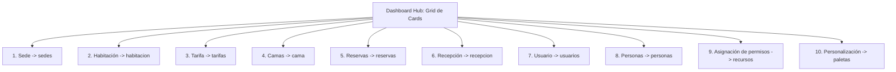

# 📋 Propuesta de Arquitectura y Diseño: Grid de Cards Interactivas y Responsivas para el Dashboard de Nexora

> **Documento de Especificación y Propuesta Técnica**  
> **Ubicación:** `prompt/propuesta-dashboard-grid-cards.md`  
> **Sistema:** Nexora Hotel Management Platform  
> **Módulo:** `src/features/dashboard/`  
> **Fecha:** Septiembre 2026  

---

## 📑 Tabla de Contenidos
1. [Visión General y Objetivo](#1-visión-general-y-objetivo)
2. [Arquitectura del Layout y Grid Responsivo](#2-arquitectura-del-layout-y-grid-responsivo)
3. [Catálogo de las 10 Cards Interactivas](#3-catálogo-de-las-10-cards-interactivas)
4. [Anatomía de Cada Card y Affordance Visual](#4-anatomía-de-cada-card-y-affordance-visual)
5. [Microinteracciones y Animación Física (Framer Motion)](#5-microinteracciones-y-animación-física-framer-motion)
6. [Diseño de Código y Componentes Propuestos](#6-diseño-de-código-y-componentes-propuestos)
7. [Psicología Cognitiva y UX Ética](#7-psicología-cognitiva-y-ux-ética)
8. [Estrategia de Integración en el Dashboard](#8-estrategia-de-integración-en-el-dashboard)
9. [Prompt Técnico Listo para Ejecución](#9-prompt-técnico-listo-para-ejecución)

---

## 1. Visión General y Objetivo

El objetivo de esta propuesta es transformar la pantalla principal del panel de control (`HomeOverview`) en un **Centro de Comando Visual e Interactivo** basado en un grid de tarjetas inteligentes (*Bento/Card Grid*). 

Cada tarjeta representa un pilar operativo de Nexora y funciona como una puerta de entrada directa (*portal interactivo*) hacia su módulo correspondiente, proporcionando:
- **Navegabilidad con un solo clic:** Al pulsar en cualquier punto de la tarjeta (o presionar `Enter`/`Space` con foco de teclado), el usuario navega fluidamente hacia la vista del módulo.
- **Previsualización de estado (*At-a-glance awareness*):** Métricas en vivo, badges de disponibilidad y accesos rápidos sin sobrecargar al usuario.
- **Responsividad fluida:** Adaptación perfecta desde smartphones compactos ($360\text{px}$) hasta monitores ultrawide ($4\text{K}$).
- **Fidelidad al Design System:** Uso estricto de tokens de color HSL (`primary`, `panel`, `line`, `ink`, `canvas`), elevaciones sutiles y modo oscuro nativo.

---

## 2. Arquitectura del Layout y Grid Responsivo

Para garantizar que el grid luzca equilibrado y estéticamente superior en cualquier dispositivo, se implementa una rejilla fluida con Tailwind CSS y CSS Grid:

```css
/* Layout responsivo escalonado */
grid-cols-1 sm:grid-cols-2 lg:grid-cols-3 xl:grid-cols-4 2xl:grid-cols-5
```

### Tabla de Comportamiento por Breakpoint

| Breakpoint | Dispositivo | Columnas | Distribución de las 10 Cards | Espaciado (`gap`) |
| :--- | :--- | :---: | :--- | :---: |
| **`< 640px` (Móvil)** | Smartphones | `1` | 10 filas verticales de fácil alcance táctil | `gap-4` ($16\text{px}$) |
| **`640px - 1023px` (Tablet)** | iPad / Tablets | `2` | 5 filas de 2 columnas balanceadas | `gap-5` ($20\text{px}$) |
| **`1024px - 1279px` (Laptop)** | Portátiles estándar | `3` | 3 filas (3 + 3 + 3) + 1 card destacada o ancho completo | `gap-6` ($24\text{px}$) |
| **`1280px - 1535px` (Desktop)** | Monitores Full HD | `4` | 2 filas de 4 + 2 cards de control central | `gap-6` ($24\text{px}$) |
| **`≥ 1536px` (Wide)** | Pantallas UltraWide | `5` | 2 filas exactas de 5 cards | `gap-6` ($24\text{px}$) |

---

## 3. Catálogo de las 10 Cards Interactivas

A continuación se detalla la configuración de las 10 tarjetas solicitadas, su identificador de navegación en `src/features/dashboard/ui/navigation.ts`, su icono nativo y la acción que desencadena el clic:



### Detalle Específico de Cada Módulo

| # | Sección | `NavId` destino | Icono | Métrica / Resumen en la Card | Acción al Clic |
| :---: | :--- | :---: | :---: | :--- | :--- |
| **1** | **Sede** | `'sedes'` | `BuildingIcon` | • Total sedes hoteleras activas<br>• Estado de la red (Central, Costa, Valle) | Navega a `SedesView` para gestionar hoteles |
| **2** | **Habitación** | `'habitacion'` | `BedIcon` | • Habitaciones libres vs. ocupadas<br>• Mantenimiento y limpieza | Navega a `HabitacionesPage` con control de inventario |
| **3** | **Tarifa** | `'tarifas'` | `TagIcon` | • Tarifa estándar y fin de semana<br>• Vigencias activas e historial | Navega a `TarifasPage` con registro de precios |
| **4** | **Camas** | `'cama'` | `CubeIcon` | • Mobiliario y camas en 3D interactivo<br>• Capacidad máxima de personas | Navega a `Cama3dPage` para visor tridimensional |
| **5** | **Reservas** | `'reservas'` | `CalendarIcon` | • Check-ins programados hoy<br>• Estado de estancias confirmadas | Navega a `ReservasPage` con tabla y formulario |
| **6** | **Recepción** | `'recepcion'` | `ConciergeBellIcon` | • Huéspedes en lobby y entrega de llaves<br>• Validación de garantía | Navega a `RecepcionesPage` (Check-in ágil) |
| **7** | **Usuario** | `'usuarios'` | `UserIcon` | • Colaboradores y recepcionistas<br>• Sede asignada y rol operativo | Navega a `UsuariosPage` para altas y estados |
| **8** | **Personas** | `'personas'` | `UsersIcon` | • Directorio de clientes y huéspedes<br>• Cédulas, pasaportes y contactos | Navega a `PersonasPage` con registro blindado |
| **9** | **Asignación de permisos** | `'recursos'` | `ShieldIcon` | • Matriz de roles y recursos<br>• Seguridad granular de accesos | Navega a `RecursosPage` para gestión de permisos |
| **10** | **Personalización** | `'paletas'` | `PaletteIcon` | • Paleta de color activa<br>• Modo claro/oscuro y atmósfera visual | Navega a `PaletteView` para temas dinámicos |

---

## 4. Anatomía de Cada Card y Affordance Visual

Cada tarjeta está diseñada para comunicar **cliqueabilidad inmediata** sin requerir instrucciones adicionales:

```
┌─────────────────────────────────────────────────────────────┐
│ 🏢 Sede                                          [Activas: 3]│  <- Header: Icono, Título y Badge
├─────────────────────────────────────────────────────────────┤
│ Hotel Nexora Central, Costa & Valle                         │  <- Subtítulo / Descripción
│                                                             │
│ ┌─────────────────────────────────────────────────────────┐ │
│ │ 3 Sedes operativas · 100% en línea                      │ │  <- Métrica o Estado Visual
│ └─────────────────────────────────────────────────────────┘ │
├─────────────────────────────────────────────────────────────┤
│ Gestionar sedes                              → [Flecha SVG] │  <- Call-To-Action sutil
└─────────────────────────────────────────────────────────────┘
```

### Características de la Anatomía:
1. **Contenedor Principal Clickable (`<article>` o `<button>` semántico):**
   - Cursor pointer (`cursor-pointer`).
   - Borde sutil `border-line` que se ilumina con `hover:border-primary/40`.
   - Fondo traslúcido con desenfoque de cristal (`bg-panel/90 backdrop-blur-xs`).
2. **Icono con Contenedor Tonal:**
   - Cada sección cuenta con un fondo pastel/traslúcido distintivo (ej. azul para sedes, esmeralda para recepción, índigo para camas 3D).
3. **Badge de Estado Contextual:**
   - Refleja el pulso del sistema (ej. "En vivo", "3 activas", "3D", "Seguro").
4. **Flecha de Acompañamiento (`ChevronRightIcon`):**
   - Se desplaza ligeramente hacia la derecha (`group-hover:translate-x-1 transition-transform`) al posar el cursor, indicando movimiento hacia adelante.

---

## 5. Microinteracciones y Animación Física (Framer Motion)

Para garantizar que el dashboard se sienta vivo, fluido y de calidad prémium (*Apple/Stripe grade*), se configuran animaciones inerciales con la librería **Framer Motion**:

```tsx
import { motion } from 'motion/react'

export const cardContainerVariants = {
  hidden: { opacity: 0 },
  visible: {
    opacity: 1,
    transition: {
      staggerChildren: 0.05, // Entrada en cascada elegante
      delayChildren: 0.1,
    },
  },
}

export const cardItemVariants = {
  hidden: { opacity: 0, y: 16, scale: 0.98 },
  visible: {
    opacity: 1,
    y: 0,
    scale: 1,
    transition: {
      type: 'spring',
      stiffness: 350,
      damping: 24,
    },
  },
}
```

### Interacción Táctil y Hover
- **Hover:** `whileHover={{ y: -4, scale: 1.015, transition: { duration: 0.2 } }}`
- **Tap / Active:** `whileTap={{ scale: 0.985 }}`
- **Focus accesible:** `focus-visible:ring-2 focus-visible:ring-primary focus-visible:ring-offset-2`

---

## 6. Diseño de Código y Componentes Propuestos

### 6.1. Definición del Dominio (`src/features/dashboard/domain/dashboard-card.ts`)

```typescript
import type { NavId } from '../ui/navigation'

export interface DashboardCardDefinition {
  id: NavId
  title: string
  subtitle: string
  badgeText: string
  badgeVariant?: 'neutral' | 'success' | 'accent' | 'warning'
  iconName: string
  accentColor: string
  highlightMetric?: string
  description: string
}

export const DASHBOARD_CARDS: readonly DashboardCardDefinition[] = [
  {
    id: 'sedes',
    title: 'Sedes',
    subtitle: 'Red hotelera y ubicaciones',
    description: 'Administra sedes principales, sucursales y torres de habitaciones.',
    badgeText: 'Activas',
    badgeVariant: 'success',
    iconName: 'BuildingIcon',
    accentColor: 'from-blue-500/10 to-indigo-500/10 text-blue-600 dark:text-blue-400',
    highlightMetric: 'Hoteles conectados',
  },
  {
    id: 'habitacion',
    title: 'Habitaciones',
    subtitle: 'Inventario y disponibilidad',
    description: 'Control de estados: disponibles, ocupadas, limpieza o mantenimiento.',
    badgeText: 'En tiempo real',
    badgeVariant: 'accent',
    iconName: 'BedIcon',
    accentColor: 'from-emerald-500/10 to-teal-500/10 text-emerald-600 dark:text-emerald-400',
    highlightMetric: 'Catálogo de estancias',
  },
  {
    id: 'tarifas',
    title: 'Tarifas',
    subtitle: 'Precios, vigencias y turnos',
    description: 'Configura esquemas de cobro por noche, horas, días y fin de semana.',
    badgeText: 'Vigentes',
    badgeVariant: 'accent',
    iconName: 'TagIcon',
    accentColor: 'from-amber-500/10 to-orange-500/10 text-amber-600 dark:text-amber-400',
    highlightMetric: 'Planes comerciales',
  },
  {
    id: 'cama',
    title: 'Camas en 3D',
    subtitle: 'Mobiliario tridimensional',
    description: 'Explora modelos 3D interactivos, rotación 360° y capacidades de camas.',
    badgeText: '3D Interactivo',
    badgeVariant: 'neutral',
    iconName: 'CubeIcon',
    accentColor: 'from-violet-500/10 to-purple-500/10 text-violet-600 dark:text-violet-400',
    highlightMetric: 'Visualizador espacial',
  },
  {
    id: 'reservas',
    title: 'Reservas',
    subtitle: 'Check-ins y estancias',
    description: 'Registro de huéspedes con selección de sede, fechas y tarifas dinámicas.',
    badgeText: 'Confirmadas',
    badgeVariant: 'success',
    iconName: 'CalendarIcon',
    accentColor: 'from-sky-500/10 to-cyan-500/10 text-sky-600 dark:text-sky-400',
    highlightMetric: 'Gestor de ocupación',
  },
  {
    id: 'recepcion',
    title: 'Recepción',
    subtitle: 'Recepción y entrega de llaves',
    description: 'Atención en mostrador, asignación de cuartos y depósitos de garantía.',
    badgeText: 'Front desk',
    badgeVariant: 'accent',
    iconName: 'ConciergeBellIcon',
    accentColor: 'from-rose-500/10 to-pink-500/10 text-rose-600 dark:text-rose-400',
    highlightMetric: 'Atención ágil',
  },
  {
    id: 'usuarios',
    title: 'Usuarios',
    subtitle: 'Equipo y colaboradores',
    description: 'Gestión de operadores del sistema, roles asignados y sedes autorizadas.',
    badgeText: 'Equipo',
    badgeVariant: 'neutral',
    iconName: 'UserIcon',
    accentColor: 'from-indigo-500/10 to-blue-500/10 text-indigo-600 dark:text-indigo-400',
    highlightMetric: 'Cuentas seguras',
  },
  {
    id: 'personas',
    title: 'Personas',
    subtitle: 'Directorio de huéspedes',
    description: 'Registro civil, documentos de identidad, canales de contacto y proveedores.',
    badgeText: 'Directorio',
    badgeVariant: 'neutral',
    iconName: 'UsersIcon',
    accentColor: 'from-fuchsia-500/10 to-pink-500/10 text-fuchsia-600 dark:text-fuchsia-400',
    highlightMetric: 'Fichas de clientes',
  },
  {
    id: 'recursos',
    title: 'Asignación de permisos',
    subtitle: 'Control de acceso granular',
    description: 'Define qué pantallas, módulos y acciones puede ejecutar cada perfil.',
    badgeText: 'Seguridad',
    badgeVariant: 'warning',
    iconName: 'ShieldIcon',
    accentColor: 'from-amber-500/10 to-red-500/10 text-amber-600 dark:text-amber-400',
    highlightMetric: 'Políticas RBAC',
  },
  {
    id: 'paletas',
    title: 'Personalización',
    subtitle: 'Colores y tema visual',
    description: 'Ajusta la paleta cromática, contrastes y estética para toda la plataforma.',
    badgeText: 'Estilo',
    badgeVariant: 'accent',
    iconName: 'PaletteIcon',
    accentColor: 'from-emerald-500/10 to-cyan-500/10 text-primary',
    highlightMetric: 'Atmósfera Nexora',
  },
] as const
```

---

### 6.2. Componente de la Card Interactiva (`src/features/dashboard/ui/molecules/dashboard-nav-card.tsx`)

```tsx
import { motion } from 'motion/react'
import type { DashboardCardDefinition } from '../../domain/dashboard-card'
import type { NavId } from '../navigation'
import {
  BuildingIcon,
  BedIcon,
  TagIcon,
  CubeIcon,
  CalendarIcon,
  ConciergeBellIcon,
  UserIcon,
  UsersIcon,
  ShieldIcon,
  PaletteIcon,
  ChevronRightIcon,
} from '../icons'

const ICON_MAP: Record<string, React.ComponentType<{ className?: string }>> = {
  BuildingIcon,
  BedIcon,
  TagIcon,
  CubeIcon,
  CalendarIcon,
  ConciergeBellIcon,
  UserIcon,
  UsersIcon,
  ShieldIcon,
  PaletteIcon,
}

export interface DashboardNavCardProps {
  card: DashboardCardDefinition
  onNavigate: (id: NavId) => void
}

export function DashboardNavCard({ card, onNavigate }: DashboardNavCardProps) {
  const IconComponent = ICON_MAP[card.iconName] ?? BuildingIcon

  return (
    <motion.button
      type="button"
      onClick={() => onNavigate(card.id)}
      whileHover={{ y: -4, scale: 1.015 }}
      whileTap={{ scale: 0.985 }}
      transition={{ type: 'spring', stiffness: 400, damping: 26 }}
      aria-label={`Ir a la sección de ${card.title}: ${card.subtitle}`}
      className="group relative flex flex-col justify-between overflow-hidden rounded-2xl border border-line bg-panel p-5 sm:p-6 text-left shadow-xs transition-colors hover:border-primary/40 hover:shadow-md focus:outline-hidden focus-visible:ring-2 focus-visible:ring-primary focus-visible:ring-offset-2"
    >
      {/* Resplandor decorativo con el color tonal de la sección */}
      <div
        className={`pointer-events-none absolute -right-12 -top-12 size-36 rounded-full bg-linear-to-br ${card.accentColor} opacity-20 blur-2xl transition-opacity group-hover:opacity-40`}
        aria-hidden="true"
      />

      <div>
        {/* Cabecera de la Card: Icono + Badge */}
        <div className="flex items-center justify-between gap-3">
          <div
            className={`flex size-12 shrink-0 items-center justify-center rounded-xl bg-linear-to-br ${card.accentColor} shadow-inner transition-transform group-hover:scale-105`}
          >
            <IconComponent className="size-6" />
          </div>

          <span className="inline-flex items-center rounded-full border border-line/80 bg-canvas/80 px-2.5 py-0.5 text-[11px] font-semibold tracking-wide text-ink-muted group-hover:border-primary/20 group-hover:text-primary transition-colors">
            {card.badgeText}
          </span>
        </div>

        {/* Títulos y descripción explicativa */}
        <div className="mt-4">
          <h3 className="text-lg font-bold text-ink transition-colors group-hover:text-primary">
            {card.title}
          </h3>
          <p className="text-xs font-medium text-ink-muted">
            {card.subtitle}
          </p>
          <p className="mt-2 text-xs leading-relaxed text-ink-muted/80 line-clamp-2">
            {card.description}
          </p>
        </div>
      </div>

      {/* Footer interactivo con llamada a la acción */}
      <div className="mt-5 flex items-center justify-between border-t border-line/50 pt-3 text-xs font-semibold text-ink-muted group-hover:text-primary transition-colors">
        <span>{card.highlightMetric ?? 'Acceder al módulo'}</span>
        <div className="flex size-7 items-center justify-center rounded-full bg-canvas/60 text-ink-muted group-hover:bg-primary group-hover:text-white transition-all shadow-2xs">
          <ChevronRightIcon className="size-4 transition-transform group-hover:translate-x-0.5" />
        </div>
      </div>
    </motion.button>
  )
}
```

---

### 6.3. Contenedor del Grid (`src/features/dashboard/ui/organisms/dashboard-card-grid.tsx`)

```tsx
import { motion } from 'motion/react'
import { DASHBOARD_CARDS } from '../../domain/dashboard-card'
import type { NavId } from '../navigation'
import { DashboardNavCard } from '../molecules/dashboard-nav-card'

export interface DashboardCardGridProps {
  onNavigate: (id: NavId) => void
  className?: string
}

export function DashboardCardGrid({ onNavigate, className = '' }: DashboardCardGridProps) {
  return (
    <section
      aria-label="Panel principal de accesos y módulos operativos"
      className={className}
    >
      <div className="mb-4 flex flex-col justify-between gap-1 sm:flex-row sm:items-center">
        <div>
          <h2 className="text-lg font-bold text-ink sm:text-xl">
            Módulos del hotel
          </h2>
          <p className="text-xs text-ink-muted sm:text-sm">
            Selecciona cualquiera de las tarjetas para acceder a su pantalla de gestión.
          </p>
        </div>
        <span className="hidden sm:inline-flex items-center gap-1.5 rounded-full border border-line bg-panel px-3 py-1 text-xs font-medium text-ink-muted">
          <span className="size-2 rounded-full bg-emerald-500 animate-pulse" />
          10 módulos disponibles
        </span>
      </div>

      <motion.div
        initial="hidden"
        animate="visible"
        variants={{
          hidden: { opacity: 0 },
          visible: {
            opacity: 1,
            transition: { staggerChildren: 0.04 },
          },
        }}
        className="grid grid-cols-1 gap-4 sm:grid-cols-2 lg:grid-cols-3 xl:grid-cols-4 2xl:grid-cols-5 sm:gap-5 lg:gap-6"
      >
        {DASHBOARD_CARDS.map((card) => (
          <DashboardNavCard
            key={card.id}
            card={card}
            onNavigate={onNavigate}
          />
        ))}
      </motion.div>
    </section>
  )
}
```

---

## 7. Psicología Cognitiva y UX Ética

Siguiendo las directrices del proyecto y las leyes de diseño centrado en el ser humano:

1. **Ley de Fitts (Facilidad de Selección):**
   - Cada tarjeta actúa como una diana amplia de interacción ($> 180\text{px}$ de altura), reduciendo el tiempo de adquisición del objetivo tanto en pantallas táctiles como con cursor.
2. **Reducción de la Carga Cognitiva (Ley de Miller / Chunking):**
   - La información de cada sección se agrupa en 3 niveles de lectura: *Identificador visual (Icono/Badge)*, *Concepto clave (Título/Subtítulo)* y *Acción de entrada (CTA)*.
3. **Certidumbre Psicológica (Principio de No Sorpresa):**
   - El título y subtítulo coinciden exactamente con la pantalla de destino. El usuario sabe con $100\%$ de certeza adónde será llevado antes de pulsar.
4. **Respeto a la Accesibilidad (WCAG 2.1 AA):**
   - Todas las cards son navegables mediante la tecla `Tab`.
   - Etiquetas `aria-label` descriptivas para lectores de pantalla.
   - Contrastes de color certificados ($> 4.5:1$).

---

## 8. Estrategia de Integración en el Dashboard

Para integrar el grid sin romper la estructura actual del proyecto, se incorpora en [src/features/dashboard/ui/organisms/home-overview.tsx](file:///d:/React/nexora/src/features/dashboard/ui/organisms/home-overview.tsx):

```diff
 export function HomeOverview({ onNavigate }: HomeOverviewProps) {
   return (
     <div className="space-y-10">
       <StatGrid />
+      {/* Grid Interactivo de las 10 Secciones del Hotel */}
+      {onNavigate && <DashboardCardGrid onNavigate={onNavigate} />}
       <OccupancyChart />
       <RecentReservations onNavigateToReservas={() => onNavigate?.('reservas')} />
       <RecepcionesDashboardSection onNavigateToRecepcion={() => onNavigate?.('recepcion')} />
     </div>
   )
 }
```

Esto sitúa el panel de navegación de forma destacada, otorgando al supervisor hotelero control total de la plataforma en la primera pantalla que observa al iniciar sesión.

---

## 9. Prompt Técnico Listo para Ejecución

Si deseas que un agente o subagente ejecute esta implementación de forma inmediata, puedes utilizar el siguiente prompt:

```text
@[src/features/dashboard/ui/organisms/home-overview.tsx] , @[src/features/dashboard/ui/navigation.ts]

Implementa el nuevo grid interactivo y responsive de tarjetas para el dashboard de Nexora cumpliendo con las siguientes especificaciones:

1. Creación de Dominio y Definición de Cards:
   - Crea el archivo `src/features/dashboard/domain/dashboard-card.ts` definiendo las 10 tarjetas:
     • Sede ('sedes')
     • Habitación ('habitacion')
     • Tarifa ('tarifas')
     • Camas ('cama')
     • Reservas ('reservas')
     • Recepción ('recepcion')
     • Usuario ('usuarios')
     • Personas ('personas')
     • Asignación de permisos ('recursos')
     • Personalización ('paletas')

2. Componente de Tarjeta Interactiva:
   - Crea `src/features/dashboard/ui/molecules/dashboard-nav-card.tsx`.
   - Al hacer clic en cualquier tarjeta, ejecuta `onNavigate(card.id)` para redirigir a su vista.
   - Aplica microinteracciones con Framer Motion (whileHover con elevación sutil, whileTap, cambio de borde a hover:border-primary/40).
   - Utiliza los iconos SVG correspondientes de `src/features/dashboard/ui/icons.tsx`.

3. Contenedor de Grid Responsivo:
   - Crea `src/features/dashboard/ui/organisms/dashboard-card-grid.tsx` con grid CSS:
     `grid grid-cols-1 sm:grid-cols-2 lg:grid-cols-3 xl:grid-cols-4 2xl:grid-cols-5 gap-4 sm:gap-6`.

4. Integración en el Dashboard:
   - Agrega `<DashboardCardGrid onNavigate={onNavigate} />` dentro de `src/features/dashboard/ui/organisms/home-overview.tsx`.
   - Asegura compatibilidad con el modo oscuro y tokens de diseño existentes en Nexora.
```
